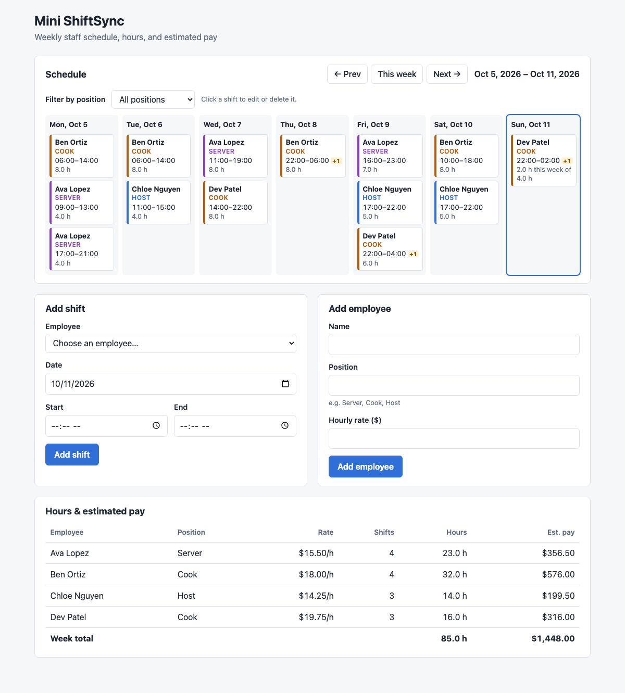

# Mini ShiftSync

A small staff-scheduling app: a scaled-down prototype of our capstone project, ShiftSync, built to evaluate the **React + Spring Boot** stack. You add employees and their shifts. The app rejects shifts that overlap and shows a weekly schedule with each employee's total hours and estimated pay.

Everything runs locally. There is no database or cloud service; data is saved to a JSON file.

## 🎥 Demo video

**[▶ Watch the demo on YouTube](https://youtu.be/loR_olZrf5I)**

[](https://youtu.be/loR_olZrf5I)

## Screenshot



## Features

- **Employees:** add with name, position, and hourly rate.
- **Shifts:** add with date, start, and end time. A shift whose end time is before its start time ends the next day (e.g. 22:00 to 06:00).
- **Overlap rejection:** a shift that overlaps one of the same employee's shifts is rejected, with the reason shown in the UI (e.g. *"Ava Lopez already has a shift on Mon, Oct 5 from 09:00 to 13:00 that overlaps this one."*). Back-to-back and split shifts on the same day are allowed.
- **Weekly view:** a Monday-to-Sunday grid with previous/next week navigation.
- **Hours and estimated pay** per employee and for the week. Overnight shifts that cross into the next week are split between the two weeks.
- **Stretch goals:** filter by position, and edit or delete shifts (click a shift card).
- **Persistence:** data is saved to `backend/data/shiftsync.json` and survives restarts. The first run seeds four employees and sample shifts for next week.

## Tech stack

| Part | Technology |
|---|---|
| Backend | Java 25, Spring Boot 4.1 (Spring Web MVC, Bean Validation), Maven (via the included wrapper) |
| Persistence | A JSON file, read and written with Jackson |
| Backend tests | JUnit 5 and AssertJ (35 tests) |
| Frontend | React 19, Vite 8, plain JavaScript, `fetch`, plain CSS |

## Running it locally

### Prerequisites

- **JDK 25** or newer (`java -version`). Maven does not need to be installed; `./mvnw` downloads it.
- **Node.js 20.19+** or **22.12+** (`node -v`), which includes npm.

### Start the app (two terminals)

```bash
# Terminal 1: backend API on http://localhost:8080
cd backend
./mvnw spring-boot:run
```

```bash
# Terminal 2: frontend on http://localhost:5173
cd frontend
npm install        # first time only
npm run dev
```

Open **http://localhost:5173**.

Always start the backend from inside `backend/`, because the data file path is relative to that folder.

### Reset to sample data

Stop the backend, delete `backend/data/shiftsync.json`, and start it again. The sample shifts are generated for next week, so click **Next →** to see them.

### Run the tests

```bash
cd backend && ./mvnw test           # 35 JUnit tests
cd frontend && npm run lint         # oxlint
```

## Project structure

```
backend/src/main/java/com/minishiftsync/
├── model/      Employee, Shift (Java records)
├── store/      DataStore (in-memory lists + JSON file), SampleData, StoreData
├── service/    SchedulingService (use cases), ScheduleRules (pure rules: overlap, hours, pay)
└── web/        REST controllers, request DTOs with validation, error handler, CORS config
frontend/src/
├── api.js          every call to the backend
├── App.jsx         page state: selected week, filter, shift being edited
└── components/     WeekGrid, ShiftForm, AddEmployeeForm, EmployeeTotalsTable, ...
```

Requests flow **Controller → Service → DataStore**. The business rules live in `ScheduleRules`, a plain Java class with no Spring or file dependencies, so they can be unit tested directly.

## API

| Method | Path | Description |
|---|---|---|
| `GET` | `/api/employees` | List employees |
| `GET` | `/api/employees/{id}` | One employee |
| `POST` | `/api/employees` | Create `{name, position, hourlyRate}` → 201 |
| `GET` | `/api/shifts?employeeId=` | List shifts (optionally for one employee) |
| `POST` | `/api/shifts` | Create `{employeeId, date, startTime, endTime}` → 201, or 409 on overlap |
| `PUT` | `/api/shifts/{id}` | Replace a shift → 200, or 404 / 409 |
| `DELETE` | `/api/shifts/{id}` | Delete → 204, or 404 |
| `GET` | `/api/schedule/week?date=&position=` | The Mon–Sun week containing `date` (default: today): shifts plus hours and pay per employee |

Dates are `yyyy-MM-dd` and times are `HH:mm`. Errors use the standard [RFC 9457 problem details](https://www.rfc-editor.org/rfc/rfc9457) format, `{status, title, detail, fieldErrors?}`, so the frontend always shows `detail`.

Example:

```bash
curl -H "Content-Type: application/json" \
  -d '{"employeeId":1,"date":"2026-10-12","startTime":"22:00","endTime":"06:00"}' \
  localhost:8080/api/shifts
```

## Design decisions and tradeoffs

| Decision | Why | Main alternative |
|---|---|---|
| **Maven** | Declarative, predictable, and the most common choice in Spring docs | Gradle: faster builds and shorter scripts, but harder to read and slower to support new JDKs |
| **Vite** | Near-instant dev server and hot reload, and the current standard for React apps | Create React App: deprecated and much slower. Next.js: overkill when Spring is already the backend. |
| **JSON file** | No setup, easy to inspect, and enough to prototype the API | A real database. See the limitations below. |
| **CORS configured in Spring** | Explicit, and it works the same in development and production | A Vite dev proxy: no CORS needed in development, but it doesn't exist in production |
| **Validation on the server only** (forms use `noValidate`) | The server is the single source of truth, and its messages appear inline under each field | Duplicating the rules in the browser gives instant feedback but means keeping two copies in sync. Client-side checks are only a convenience; the server check is the real protection. |
| **Shift stored as date + start + end** | Matches how people enter shifts; overnight is inferred when end < start | Full start/end date-times: more flexible (allows shifts of 24h or longer) but a clunkier form |
| **Half-open intervals** `[start, end)` | A shift ending at 13:00 and one starting at 13:00 don't overlap | Closed intervals would wrongly reject back-to-back shifts |
| **Hours counted in the week worked** | Matches payroll workweeks: a Sunday 22:00–02:00 shift is 2h in each week | Charge the whole shift to its start date: simpler, but misstates hours |
| **`BigDecimal` for money**, rounded once per employee | `double` can't represent cents exactly, and rounding each shift first can drift by a cent | `double` or `long` cents |
| **Totals and filtering calculated by the backend** | One place does the money math; React only displays it | Recalculating in React risks the two disagreeing |

## Known limitations of this prototype

These are acceptable for a prototype, but the real ShiftSync, with a relational database, will need to handle them:

- **One server process only.** Thread safety comes from `synchronized`, which works inside a single JVM. Two servers sharing the file would overwrite each other's changes. A database transaction or constraint solves this.
- **Every change rewrites the whole file**, and every query scans every shift in memory. That's fine at this scale, but costs grow with the data. A database writes only the changed rows and uses indexes for queries.
- **No referential integrity or migrations.** Nothing but our own code links shifts to employees, and changing the file format means writing the migration by hand.
- **Not covered:** authentication, overtime rules, time zones and daylight-saving transitions, editing or deleting employees, frontend tests.

The layering keeps a database migration small: replacing `DataStore` with Spring Data JPA repositories would leave the service, rules, controllers, and frontend almost unchanged.
